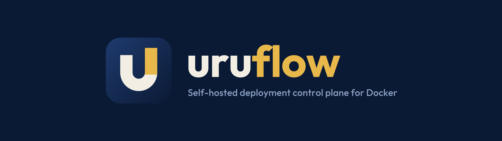
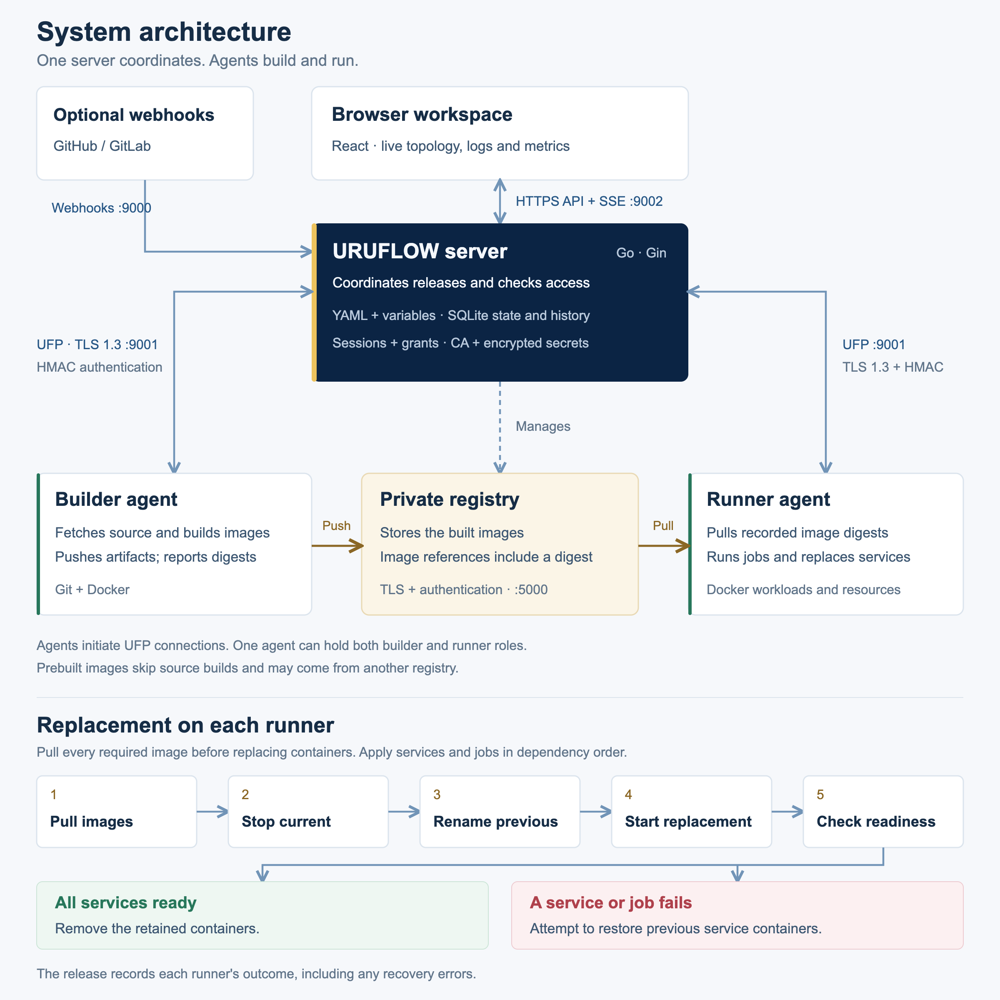

<p align="center">
  
</p>

<p align="center">
  <a href="internal/version/version.go"></a>
  <a href="https://github.com/mustafanass/uruflow/actions/workflows/quality.yml"></a>
  <a href="LICENSE"></a>
  <a href="go.mod"></a>
  <a href="docs/protocol.md"></a>
</p>

<p align="center">
  <a href="docs/getting-started.md">Getting started</a> ·
  <a href="#documentation">Documentation</a> ·
  <a href="docs/architecture.md">Architecture</a> ·
  <a href="docs/security.md">Security</a> ·
  <a href="https://github.com/mustafanass/uruflow/releases">Releases</a>
</p>

<br>

URUFLOW is a self-hosted deployment control plane for Docker hosts. One server serves the browser
workspace, coordinates releases and manages a private image registry. Builder agents turn source
into images. Runner agents deploy the recorded image digests on their own machines.

Project YAML and variable files define what to run. SQLite holds access, release history and
observations. The React workspace is embedded in the server binary; agents report live state from
their hosts.

## What it does

- **Release by digest.** Build each source-backed service once per release, or deploy a prebuilt image by digest.
- **Check readiness.** Retain previous service containers until the runner's full release sequence succeeds.
- **Restore without rebuilding.** Create a new release from a successful release's recorded images and specification.
- **See where things run.** Live fleet and project graphs connect configuration with agent and container observations.
- **Inspect the result.** Follow release progress, runner outcomes, resource use and reconnecting log streams.
- **Control access.** Administrator, operator and viewer roles, project grants, audit records and encrypted secrets. Agents connect over TLS 1.3 UFP with HMAC authentication.

## Architecture

<p align="center">
  <a href="assets/uruflow-arch.png">
    
  </a>
</p>

<p align="center"><sub>Click to enlarge. <a href="assets/uruflow-arch.svg">Vector diagram</a> · <a href="docs/architecture.md">Ownership and system flows</a> · <a href="docs/deployments.md">Release and recovery behavior</a></sub></p>

| Listener            | Default          | Used by                                                        |
| :------------------ | :--------------- | :------------------------------------------------------------- |
| Web workspace       | `127.0.0.1:9002` | Browser API, sessions and live streams; HTTPS outside loopback |
| UFP                 | `9001`           | Agents, over TLS 1.3                                           |
| Webhooks and health | `9000`           | GitHub, GitLab and monitors                                    |
| Registry            | `5000`           | Agents, with TLS and authentication                            |

## Installation

| Binary          | Install on                                                 |
| :-------------- | :--------------------------------------------------------- |
| `uruflow`       | One Linux server with Docker                               |
| `uruflow-agent` | Each builder or runner host; one agent can hold both roles |

The server and runners need Docker Engine and socket access. Builders also need Git, the Docker
CLI and access to their source repositories.

### Download v3.0.0

Choose `amd64` for x86-64 or `arm64` for ARM64. Each archive contains one binary, its service unit and the license.

```sh
version=3.0.0
arch=amd64
binary=uruflow
archive="$binary-$version-linux-$arch.tar.gz"
base="https://github.com/mustafanass/uruflow/releases/download/v$version"
curl -fSLO "$base/$archive"
curl -fSLO "$base/SHA256SUMS.txt"
sha256sum --check --ignore-missing SHA256SUMS.txt
tar -xzf "$archive"
sudo install -m 0755 "$binary" "/usr/local/bin/$binary"
```

On builder and runner hosts, set `binary=uruflow-agent` to download and install the agent archive.

### Build from source

Use the Go version in [go.mod](go.mod), Node.js 24, npm and a C compiler for SQLite:

```sh
git clone --branch v3.0.0 --depth 1 https://github.com/mustafanass/uruflow.git
cd uruflow
make build
sudo install -m 0755 build/uruflow /usr/local/bin/uruflow
```

The build writes `build/uruflow` and `build/uruflow-agent`, with the frontend embedded in the server.
Install `build/uruflow-agent` on agent hosts. Keep the server and agents on the same release.

## Quick start

From the extracted archive or source checkout, initialize the Linux server. Replace `uruflow.internal`
with a hostname or address reachable by your agents:

```sh
sudo uruflow init --advertise uruflow.internal
sudo install -m 0644 packaging/systemd/uruflow.service /etc/systemd/system/
sudo systemctl daemon-reload
sudo systemctl enable --now uruflow
sudo cat /var/lib/uruflow/web-setup-token
```

1. Open `http://127.0.0.1:9002` locally or through an SSH tunnel. Use the setup token to create the first administrator.
2. Install `uruflow-agent` on each target machine. In **Agents → Enroll agent**, choose its roles and follow the generated command, CA certificate and startup steps.
3. In **Projects → Create project**, choose sources, agents and ports. Review **Configuration**, then select **Deploy** and follow the release logs.

The full walkthrough, including HTTPS access, is in [Getting started](docs/getting-started.md).

## Documentation

| Topic        | Read                                                                                                                      |
| :----------- | :------------------------------------------------------------------------------------------------------------------------ |
| Concepts     | [Architecture](docs/architecture.md) · [Concepts](docs/concepts.md)                                                       |
| Deploying    | [Projects](docs/projects.md) · [Build and runtime model](docs/native-build-model.md) · [Deployments](docs/deployments.md) |
| Operating    | [Browser workspace](docs/interface.md) · [Configuration](docs/configuration.md) · [Operations](docs/operations.md)        |
| Security     | [Security](docs/security.md) · [Troubleshooting](docs/troubleshooting.md) · [Upgrading](docs/upgrading.md)                |
| Contributing | [Contributing](CONTRIBUTING.md) · [Testing](docs/testing.md) · [UFP protocol](docs/protocol.md)                           |

## Development

```sh
make check
make test-integration
make test-live
make test-race
```

`make check` runs the deterministic Go and frontend checks. Integration and live lanes use explicit
infrastructure; race checks cover concurrency. [Testing](docs/testing.md) defines the prerequisites,
test ownership and local browser preview. [Contributing](CONTRIBUTING.md) covers code changes.

To prepare GitHub release downloads, run `make release`. [Building a release](CONTRIBUTING.md#building-a-release)
covers the toolchain, generated assets and upload commands.

Report security issues privately through GitHub security advisories.
Licensed under [MIT](LICENSE).
