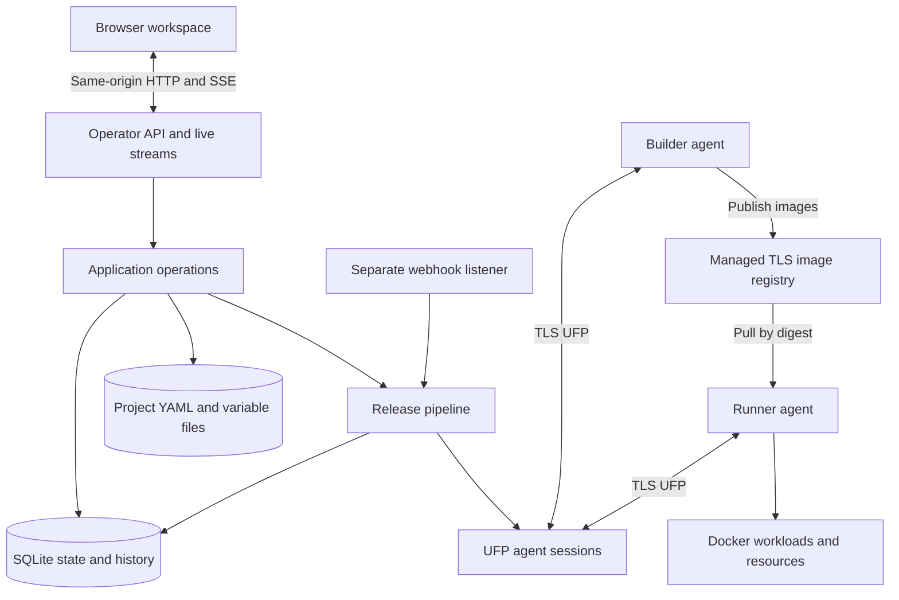

# Architecture

URUFLOW has one Go control plane, an embedded React operator workspace, and Go agents on the machines that build or run applications. This page explains ownership, the main flows and the rules that connect them.

Read [Concepts](concepts.md) for the vocabulary and [Deployments](deployments.md) for the release sequence.

## Components and connections

The frontend build precompresses text assets. The operator listener negotiates gzip for those static files and keeps live event streams separate from asset compression.

The operator, webhook, UFP and registry listeners have separate addresses. The [configuration reference](configuration.md) owns their fields and defaults.

## Data ownership

| State                                              | Owner and storage                                                        | Readers                                |
| -------------------------------------------------- | ------------------------------------------------------------------------ | -------------------------------------- |
| Desired project configuration                      | `internal/projects`; YAML and variable files beside server configuration | Operations, pipeline, browser editors  |
| Loaded project model                               | Server; SQLite projection of validated files                             | Pipeline and observations              |
| Users, grants, session hashes and audit            | `internal/web` through SQLite                                            | Protected API and stream handlers      |
| Deploy-on-push sources                             | `internal/ops` through SQLite                                            | Webhook matching, project settings     |
| Agent enrollment and observations                  | Server link and SQLite                                                   | Pipeline, scoped browser views         |
| Release specification, artifacts, targets and logs | Pipeline and SQLite                                                      | Release details, history and rollback  |
| Registry image content                             | Managed registry and its data directory                                  | Builders and runners                   |
| Secrets and encryption material                    | Encrypted SQLite values and server PKI directory                         | Dispatch-time resolution               |
| Running containers, networks and volumes           | Runner and Docker                                                        | Agent inventory and runtime operations |
| Graph positions and appearance                     | Browser storage                                                          | That browser's workspace               |

A browser cache or a graph node never becomes a configuration authority. The server derives topology from validated definitions, release records and agent observations.

## Save, deploy and observe

1. The browser sends a document and its revision to the operator API.
2. The server checks the session, role and project grant, resolves variables, validates placement and secret references, then writes the authoritative file.
3. **Deploy** claims a release and stores its resolved specification. Saving a document and starting a release are separate operations.
4. The pipeline sends work over the authenticated UFP link. Builders publish artifacts; runners apply recorded digests.
5. Agents report status, logs and container observations. The server persists release outcomes and builds scoped read models for the browser.

Closing the browser does not cancel server-owned work. Running containers continue under Docker while the control plane restarts.

## Live observations

One server observation loop samples state. Release summaries are cached against a database revision; their targets are read in a batch. List responses omit full release specifications, while a release detail loads its recorded specification.

The browser memoizes its shared context and uses observation events and a staleness deadline rather than a periodic workspace render timer.

Both HTTP listeners use Gin route groups, named domain handlers and authentication middleware. Application operations, storage and UFP remain independent of Gin. The operator router preserves strict JSON decoding, origin and CSRF protection, audit records and project grants. Custom Go HTTP servers own TLS, HTTP/2 and connection deadlines. Forwarded client addresses are not trusted by default.

A stream starts with a scoped snapshot. Later events contain changed top-level fields, and heartbeats maintain connection state. Browsers reconnect after interruptions. Tabs share a snapshot stream through browser coordination where available, and HTTPS supports HTTP/2. Log viewers have independent UFP stream identifiers.

Metrics carry validity and collection time. Missing or stale observations appear as unavailable. Graph cards subscribe to measurements by resource identity, and unchanged values retain their identity. Measurements are separate from layout inputs. The graph preserves positions during status changes and recalculates placement when topology or visible host expansion changes. Fleet placement edges combine configured assignments with observed host ownership; authorization is applied before graphs are built.

## Architecture rules

1. **Files own desired project configuration.** SQLite stores the loaded model and operational history.
2. **The API owns authorization.** Every protected read, mutation and stream checks identity and scope.
3. **The pipeline owns release state.** A request's acceptance does not mean the release completed.
4. **Each project has one active release.** Persisted reservations prevent competing deployments.
5. **A release keeps its specification.** Editing a project cannot silently rewrite an in-flight release.
6. **Artifacts are identified by digest.** Builders' results are checked before runner dispatch.
7. **Both peers enforce agent roles.** A runner receives runtime work; a builder receives build work.
8. **Runners change owned containers.** Persistent resources have their own lifetime.
9. **Observations are evidence.** Connection state, metrics validity and workload health remain distinct.
10. **`internal/ufp` is independent.** It imports no other URUFLOW package.

## Implementation map

| Area                                         | Code                                                                        |
| -------------------------------------------- | --------------------------------------------------------------------------- |
| Entry points and local recovery              | `cmd`, `internal/cli`, `internal/agent/cli`                                 |
| Server composition and webhooks              | `internal/api`, `internal/services`                                         |
| Browser API, authentication and SSE          | `internal/web`                                                              |
| Typed operations and document revisions      | `internal/ops`                                                              |
| Read models and topology                     | `internal/observe`                                                          |
| Release lifecycle and target outcomes        | `internal/pipeline`                                                         |
| Agent sessions and event handling            | `internal/link`                                                             |
| Agent process, builds, rollout and telemetry | `internal/agent`                                                            |
| Framing, handshake and payloads              | `internal/ufp`                                                              |
| Project schema and file writes               | `internal/projects`                                                         |
| SQLite, PKI, secrets and registry            | `internal/storage`, `internal/pki`, `internal/secrets`, `internal/registry` |
| Browser shell and domain pages               | `frontend/src/app`, `frontend/src/features`                                 |
| Shared UI, API client, types and tokens      | `frontend/src/shared`, `frontend/src/styles`                                |

Related: [Security](security.md), [UFP](protocol.md), [Testing](testing.md), [Contributing](../CONTRIBUTING.md).
