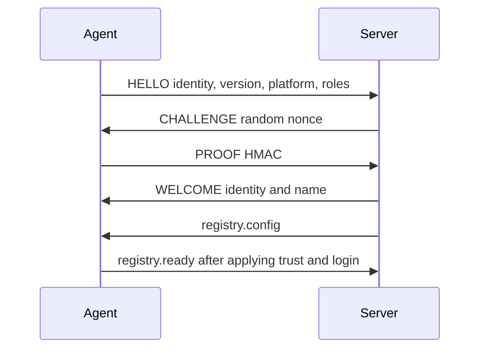

# UFP protocol

UFP is URUFLOW's persistent, bidirectional server-agent protocol. It carries instructions, acceptance responses, status, logs and observations over TLS. Browser traffic uses the operator HTTP API and SSE instead.

This is the wire reference for contributors. URUFLOW 3.0.2 uses UFP frame version `0x04`.

## Transport and framing

Agents dial the server over TCP with TLS 1.3. They verify the URUFLOW CA and logical server name `uruflow-server`. Agent identity is established by the UFP handshake after TLS.

Every frame has an eight-byte header followed by JSON payload bytes:

```text
byte      0     1     2      3          4 .. 7
value    0x55  0x46  0x04   frame type  payload length, unsigned big-endian
         U     F
```

The decoder checks magic, frame version and the 16 MiB payload bound before reading the payload. A rejected header ends the connection.

| Group     | Frame types                                                                 |
| --------- | --------------------------------------------------------------------------- |
| Handshake | `HELLO 0x01`, `CHALLENGE 0x02`, `PROOF 0x03`, `WELCOME 0x04`, `REJECT 0x05` |
| Messaging | `REQUEST 0x10`, `RESPONSE 0x11`, `EVENT 0x12`                               |
| Liveness  | `PING 0x20`, `PONG 0x21`, `GOODBYE 0x22`                                    |

## Handshake



`HELLO` includes `agent_id`, `hostname`, `version`, `platform` and `roles`. The server looks up enrollment and sends a fresh 32-byte nonce. The proof is:

```text
HMAC-SHA256(agent_key, "uruflow-agent-auth-v1" || nonce)
```

Verification uses constant-time comparison. Unknown identities follow a placeholder-key verification path. Roles must exactly match enrollment, with no unknown or duplicate entries. A failed step returns `REJECT` and closes the connection.

The key is never sent during authentication. [Security](security.md#agent-identity-and-ufp) explains credential ownership.

## Envelopes

After the handshake, messages use three envelopes:

```json
{
  "id": 7,
  "method": "logs.follow",
  "payload": {
    "container_id": "container-id",
    "stream_id": "viewer-id",
    "tail": 200
  }
}
```

```json
{ "id": 7, "ok": true, "payload": { "stream_id": "viewer-id" } }
```

```json
{
  "topic": "container.log",
  "payload": {
    "container_id": "container-id",
    "stream_id": "viewer-id",
    "stream": "stdout",
    "line": "ready",
    "timestamp": 1793520000
  }
}
```

A response correlates with the request's `id`. Failure responses use `ok: false` and an error message payload. Unknown response IDs are ignored; closing a connection releases outstanding waiters.

Requests acknowledge acceptance. Build and release completion arrives through `job.status`, not through a long-running request response. Events are processed in order. Request handlers can run concurrently, with agent job coordination protecting conflicting work.

## Methods

These methods travel from server to agent:

| Method           | Work                                                                       |
| ---------------- | -------------------------------------------------------------------------- |
| `build.run`      | Resolve Git sources, build targets and publish image digests               |
| `release.run`    | Prepare resources, pull images, execute jobs and replace services          |
| `release.stop`   | Stop a project's managed containers                                        |
| `release.remove` | Remove a project's managed containers while retaining persistent resources |
| `logs.follow`    | Follow a container's Docker output                                         |
| `logs.stop`      | Stop a selected log viewer                                                 |

Payloads include job and project identity where appropriate. Build requests carry source and target definitions. Release requests carry the remaining deadline, per-service image references, dependencies, jobs, mounts, networks, runtime controls and readiness policy.

The server checks enrolled roles before dispatch. Agents independently reject methods outside their roles and validate deployment payloads before execution.

## Events

| Direction      | Topic             | Content                                                       |
| -------------- | ----------------- | ------------------------------------------------------------- |
| Server → agent | `registry.config` | Registry address, credentials and CA                          |
| Agent → server | `registry.ready`  | Registry trust and required login applied                     |
| Agent → server | `job.log`         | Build or release output                                       |
| Agent → server | `job.status`      | Job identity, stage, status, messages and resulting artifacts |
| Agent → server | `metrics.push`    | Host samples and managed container inventory                  |
| Agent → server | `container.log`   | Output or completion for a log viewer                         |

Job stages are `build` and `release`; status events use `running`, `success` and `failed`. The server correlates job identity and reporting agent with persisted work before applying outcomes.

Build targets may carry `watch`, `previous_image` and `previous_commit`. The server supplies previous artifacts only when build settings match a successful retained release and their registry manifests exist. It checks manifests with bounded concurrent HEAD requests; registry failures stop the attempt without dispatching a rebuild. The builder compares the selected source paths before reusing the artifact. `rebuild` on the build request bypasses reuse and Docker's build cache. Build results still report every source-built service's image and original build commit. The overall commit identifies the first rebuilt service, or the first resolved source when all images are reused.

A successful release-stage status may include `containers`, mapping each long-running service name to its applied container ID. This includes unchanged containers. The server stores the map with the runner target so the browser can identify the applied release while preserving original container creation labels.

### Observations

`metrics.push` separates collection time, host availability and container inventory validity. `system.available` lists valid collectors; `system.errors` explains unavailable samples. `cpu_cores` and `metrics_sec` describe capacity and cadence. `uptime` retains process-lifetime meaning; optional `host_uptime` reports host boot age.

Container reports carry full identities, state and health, statistics availability, CPU and memory usage, traffic, PID and block-I/O counters. Optional `details` includes release and role labels, image identity, timestamps, exit and OOM state, networks, ports, mounts and health probes. Environment values are excluded from collected details.

An unavailable sample is not a zero reading. The server and browser preserve this distinction when deriving health and graphs.

### Container log viewers

`logs.follow` includes a viewer `stream_id` and may include an `after` cursor. Container log events include an opaque `cursor` with independent timestamp and ordinal checkpoints for stdout and stderr. A resumed request reads from the earlier checkpoint and skips already delivered entries separately in each stream. This preserves repeated lines and handles stdout and stderr arriving with different timestamp order. Legacy timestamp cursors remain accepted. The server emits the cursor as an SSE event ID, and the browser returns it when reconnecting.

The agent echoes the stream ID in acceptance and each `container.log`; `logs.stop` closes only that viewer. The server checks the echoed ID before accepting an independent browser stream. Requests without it use the container identity as the stream key.

When Docker output ends, an entry with `complete: true` ends the viewer. An optional `error` describes collection failure. The server turns these into browser completion or failure events. The existing topic and frame version stay unchanged.

## Connection lifecycle

The server sends registry configuration after authentication. An agent applies Docker trust and builder login before acknowledging readiness. A healthy connection then serves requests and events until cancellation, an error or `GOODBYE`.

| Timer                | Value      |
| -------------------- | ---------- |
| Handshake read       | 10 seconds |
| Frame write          | 15 seconds |
| Server ping interval | 20 seconds |
| Read idle deadline   | 60 seconds |

The read loop answers `PING` with `PONG`. On disconnect, the agent cancels in-flight work and log streams, then retries after its configured reconnect delay. Duplicate active job IDs are acknowledged without starting the same work twice.

## Error handling and compatibility

| Condition                                    | Result                      |
| -------------------------------------------- | --------------------------- |
| Bad magic, frame version or declared length  | Connection error            |
| Malformed top-level envelope                 | Frame skipped               |
| Invalid payload for a handled event          | Handler error ends the link |
| Unknown method                               | Failed response             |
| Unknown event topic or unexpected frame type | Connection error            |
| Unknown response ID                          | Ignored                     |

The product version and frame version serve different purposes. `3.0.2` identifies the application release; `0x04` identifies this wire contract. Optional observation and log-viewer fields are additive. Changes to required behavior need coordinated peer support, and incompatible frame or message semantics require a protocol-version decision.

Keep `internal/ufp` independent of other repository packages. Preserve ordered events, correlated requests, role enforcement and the acceptance/completion distinction. Update this page and contract tests in the same change as the wire code.

Implementation: `internal/ufp`, `internal/link`, `internal/agent/daemon`.

Related: [Architecture](architecture.md), [Security](security.md), [Testing](testing.md).
